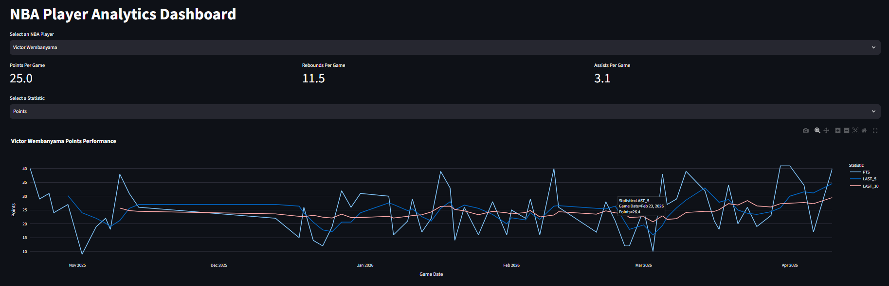
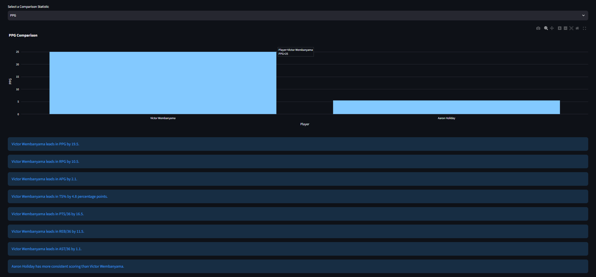
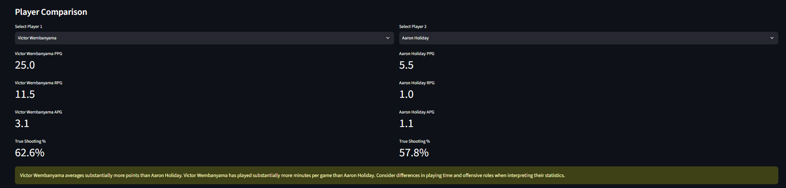

## Live Demo

Explore the interactive NBA Analytics Dashboard:

[Launch NBA Analytics Dashboard] https://emanbastatistic.streamlit.app/

# Description: 

This NBA Sports Analytics program is a dashboard built with Python, using pandas and streamlit to view and explore per player statistics, analyze performance, and compare two players performance through the course of the 2025-26 season.

## Dashboard Preview

### Player Performance Analysis

View NBA player statistics and visualize performance trends using interactive rolling averages.

### Player Comparison

Compare NBA players using advanced statistics including True Shooting Percentage, Per-36 production, and scoring consistency.

# Features:

-Interactive NBA player selection and statistical summaries.

-Performance trend visualization with 5-game and 10-game rolling averages.

-Player comparisons using PPG, RPG, APG, TS%, and Per-36 statistics.

-Scoring consistency analysis using standard deviation.

-Automated statistical insights.

-Unit testing with pytest.

# Technologies used:

-Python

-Pandas

-Streamlit

-Plotly

-nba_api

-pytest

-Git

# Install the dependencies
python -m pip install -r requirements.txt

# Launch the dashboard
python -m streamlit run app.py

# Runs the tests using pytest
python -m pytest test_analytics.py -v